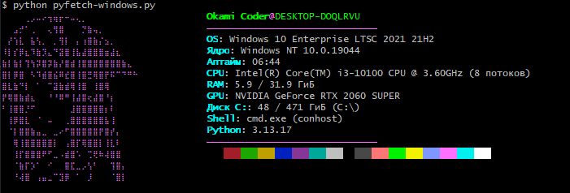

# 💻 pyfetch

<p>
  
</p>

A lightweight, cross-platform system information fetching tool written in Python. `pyfetch` detects your operating system and displays elegant system statistics directly in your terminal.

## ✨ Features

- **Cross-Platform Support:** Dedicated scripts for both Linux and Windows environments.
- **Lightweight & Fast:** Written in pure Python with minimal overhead.
- **Clean Output:** Displays essential hardware and OS metrics in a highly readable format.

## 🚀 Getting Started

### Prerequisites

- Python 3.x installed on your system.

### Installation

Clone the repository to your local machine:

```bash
git clone https://github.com/OkamiCoder/pyfetch.git
cd pyfetch
```

## 💻 Usage

Run the appropriate script based on your operating system:

### On Windows
```cmd
python pyfetch-windows.py
```

### On Linux
```bash
python pyfetch-linux.py
```

## 📂 Project Structure

```text
pyfetch/
├── pyfetch-linux.py      # System fetching logic for Linux distributions
├── pyfetch-windows.py    # System fetching logic for Windows OS
├── .gitignore            # Git ignore rules
├── LICENSE               # MIT License
└── README.md             # Project documentation
```

## 📄 License

This project is licensed under the MIT License - see the [LICENSE](LICENSE) file for details.
